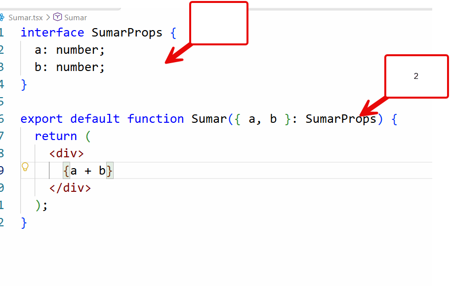
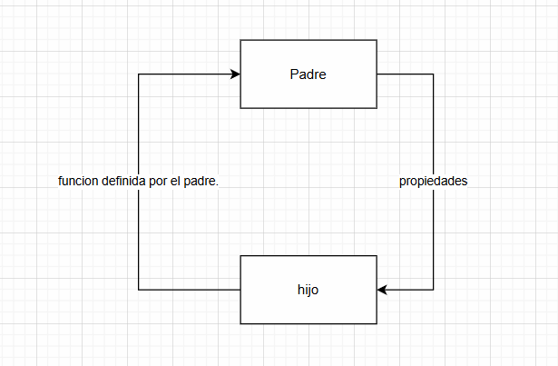

# Pasos iniciales en React

# crear el proyecto
Abra un terminal y ejecute:

```bash
pnpm create vite@latest nombre-del-proyecto --template react-ts
cd nombre-del-proyecto
```

## Limpiar el proyecto

* En la carpeta, src, borre todos los archivos salvo main.tsx
* En la carpeta, public, borre todos los archivos
* Voy a crear un componente:

## Crear un componente

* Cree un archivo, por ejemplo, `MiComponente.tsx` en la carpeta `src` 
* Dentro del archivo, escriba el siguiente código:
* .tsx = indica que es un archivo typescript y ocupa JSX.
* Todo lo que no tenga que ver con componentes de REACT, debe tener la extension .ts

* Componente como constante:
```tsx
import React from 'react';

const MiComponente: React.FC = () => {
  return (
    <div>
      Hola, soy un componente de React
    </div>
  );
};

export default MiComponente;
```
*Componente como funcion:
```tsx
import React from 'react';

function MiComponente() {
  return (
    <div>
      Hola, soy un componente de React
    </div>
  );
}

export default MiComponente;
```

# Editar main.tsx 

Luego, edite el archivo main.tsx, y quite import y referencias que ya no estan. 
Y agregue el componente que creo.


```tsx
import { StrictMode } from 'react'
import { createRoot } from 'react-dom/client'
import Componente1 from './Componente1'

createRoot(document.getElementById('root')!).render(
  <StrictMode>
    <Componente1 />
  </StrictMode>,
)
```

# correr
una vez editado, vamos a correr el codigo. Abra un terminal y ejecute:

```bash
pnpm install
pnpm run dev
```

Y abra la página web http://localhost:5173/ o la que corresponda.

# Componente con propiedades

## Ejemplo: Componente Sumar

Cree un archivo `Sumar.tsx` en la carpeta `src` con el siguiente contenido:

```tsx
export default function Sumar({ a, b }: { a: number; b: number }) {
  return (
    <div>
      {a + b}
    </div>
  );
}
```

## Llamar a la funcion

```tsx
import Sumar from './Sumar';

export default function App() {
  return (
    <div>
      <Sumar a={3} b={5} />
    </div>
  );
}
```

## escribir los parametros con interface

Por ejemplo, podemos definir una interface `SumarProps` para los parámetros del componente `Sumar`:

```tsx
interface SumarProps {
  a: number;
  b: number;
}

export default function Sumar({ a, b }: SumarProps) {
  return (
    <div>
      {a + b}
    </div>
  );
}
```



## Uso del jsx

* JSX nos permite escribir código similar a HTML dentro de nuestros componentes de React.
* cuando se usa "style" en JSX, se debe pasar un objeto con las propiedades en camelCase, por ejemplo: `<div style={{ backgroundColor: 'red' }}>Hola</div>`.
* cuando se usa "class" en JSX, se debe usar "className" en su lugar, por ejemplo: `<div className="mi-clase">Hola</div>`.
* Los elementos JSX deben estar correctamente cerrados, por ejemplo: ``.
* JSX permite usar expresiones de JavaScript dentro de llaves `{}`, por ejemplo: `<div>{2 + 2}</div>`.
* En el JSX, debe tener un nodo raiz unique.

```jsx
  <div> {/* nodo raiz, esto funciona */}
    <a>hola</a>
  </div>
```

```jsx
  <div> {/* va dar error porque hay más de un nodo raíz */}
  </div>
  <div>
  </div>
```
Se puede agrupar de la siguiente manera:
```jsx
<> {/* nodo raiz, esto funciona */}
  <div> 
  </div>
  <div>
  </div>
</>
```

# Componente Padre e Hijo



* El componente Padre pasa un mensaje al Hijo mediante la propiedad `mensaje`.
* El Hijo puede llamar a la función `function` que se define en el Padre para comunicarse de vuelta.

